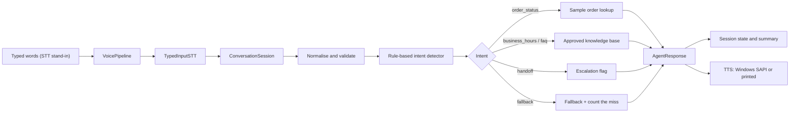

# AI Customer Calling Agent — Weeks 1–2

A working prototype of the customer-support calling agent described in
`AI_Customer_Calling_Agent_Development_Plan.docx`. Week 1 delivers the decision
layer of the agent: it understands the customer's request, looks up approved
sample data, replies in short speakable sentences, and flags calls that need a
human representative. Week 2 adds a call session with automatic escalation and
a local voice loop: typed words go in, and the reply is spoken through the
Windows voice (or printed when no voice is available).

**This is not a live phone agent yet.** No phone line, microphone or
speech-recognition engine is connected. The "customer" text is typed or supplied
by the demo script; it is not a transcript of real audio.

---

## Week 1 status

| Week 1 requirement | Status |
| --- | --- |
| Requirements, use case and architecture documented | Done — `WEEK1_DEVELOPMENT_DOCUMENT.docx` |
| Local Python prototype with the five required intents | Done — verified by tests and demo |
| Unit tests including empty input, unknown questions, invalid order numbers | Done — 27 tests, all passing |
| First working test call | **Not done** — no telephony account, credentials or test number are available (see below) |
| Professional Week 1 Word document | Done |
| Clean, GitHub-ready structure | Done |

### Calling integration: honest status

The Week 1 roadmap expects a first test call. That step could not be completed
because this environment has no approved calling platform account, no API
credentials and no test phone number. Nothing in this repository claims
otherwise, and no secret keys are stored here.

The local prototype is the verified deliverable. To move to a real call, the
following access is required:

| Access needed | Purpose |
| --- | --- |
| Telephony account (e.g. Twilio, Telnyx, Plivo) | Place and receive calls |
| Account SID / auth token (stored as environment variables) | Authenticate API requests |
| One voice-capable phone number | Caller ID and inbound calls |
| One verified test destination number | Test calls on trial accounts |
| Public HTTPS webhook (e.g. ngrok during development) | Receive call events |
| Speech-to-text API key (e.g. Deepgram, Whisper) | Transcribe customer speech |
| Text-to-speech API key (e.g. ElevenLabs, Azure) | Speak the agent's replies |
| LLM API key (Week 2 dialogue engine) | Understand free-form speech |
| Client-approved recording notice, calling hours and Do-Not-Call policy | Compliance before any live call |

---

## Week 2 status

Week 2 in the plan is about building the conversation engine. The parts that do
not depend on external accounts are implemented and tested; the parts that need
a speech or telephony provider are still blocked by the same missing access
listed above.

| Week 2 item | Status |
| --- | --- |
| Knowledge base with validated, approved FAQ entries | Done — `src/knowledge_base.py`, 14 tests |
| Call session with a 3-strike fallback escalation and handoff summary | Done — `src/session.py`, 12 tests |
| Voice loop with pluggable speech-to-text and text-to-speech interfaces | Done — `src/voice/` |
| Spoken replies | Done locally — Windows SAPI via PowerShell (2 voices detected on this machine); no API key needed |
| Streaming speech-to-text / microphone input | **Not done** — no STT account or credentials |
| Telephony test call, barge-in, latency measurement | **Not done** — no phone number, telephony account or audio stream |
| Tests and README updated for Week 2 | Done — 65 tests, 0 failures |

What "spoken replies" means here: the agent's approved text is read aloud by the
laptop's built-in Windows voice. It is not a telephony voice, and nothing is
recorded or uploaded. If the Windows voice is unavailable, the same text is
printed instead. No audio was played automatically during development; run the
demo yourself to hear it.

---

## Requirements

- Python 3.10 or newer (tested on Python 3.12.10)
- No third-party packages are needed to run the agent, the session or the tests
- Spoken output uses the built-in Windows voice (available on this Windows 10/11
  machine); on other systems the demo prints replies instead
- Optional tooling for the Week 1 Word document: see `requirements-dev.txt`

## Project structure

```text
.
├── README.md
├── WEEK1_DEVELOPMENT_DOCUMENT.docx   # generated Week 1 report (black / dark-blue theme)
├── requirements.txt                  # runtime: standard library only
├── requirements-dev.txt              # pytest + python-docx
├── .gitignore
├── src/
│   ├── __init__.py
│   ├── agent.py                      # intents, validation, replies, escalation
│   ├── knowledge_base.py             # Week 2: validated FAQ entries + lookup
│   ├── session.py                    # Week 2: call state, 3-strike escalation, summary
│   ├── cli.py                        # Week 1: simulated text call in the terminal
│   ├── sample_data.py                # clearly fictional orders, hours and FAQs
│   └── voice/                        # Week 2: voice loop
│       ├── __init__.py
│       ├── pipeline.py               # STT -> session -> TTS, pluggable protocols
│       ├── stt.py                    # typed-input STT stand-in (no microphone)
│       ├── tts.py                    # Windows SAPI voice + printed fallback
│       └── demo.py                   # simulated call: typed in, spoken out
├── tests/
│   ├── __init__.py
│   ├── test_agent.py                 # 27 Week 1 tests
│   ├── test_knowledge_base.py        # 14 Week 2 tests
│   ├── test_session.py               # 12 Week 2 tests
│   └── test_voice_pipeline.py        # 12 Week 2 tests
├── docs/
│   ├── WEEK1_DEVELOPMENT_DOCUMENT.md # source of the Week 1 Word document
│   ├── test_results.txt              # real Week 1 test output
│   ├── week2_test_results.txt        # real Week 2 test output (65 tests)
│   ├── demo_transcript.txt           # real Week 1 demo output
│   └── week2_demo_transcript.txt     # real Week 2 demo output
└── scripts/
    └── build_week1_document.py       # regenerates the Week 1 .docx from the .md
```

## Setup

Optional virtual environment (recommended, not required):

```bash
python -m venv .venv
# Windows PowerShell
.venv\Scripts\Activate.ps1
# macOS / Linux
source .venv/bin/activate
```

There are no runtime dependencies to install. For the optional test runner and
document builder:

```bash
pip install -r requirements-dev.txt
```

## Run the simulated call

From the project root:

```bash
python -m src.cli          # interactive chat
python -m src.cli --demo   # fixed sample conversation
```

Type `exit` or `quit`, or press Ctrl+C, to end the session. Each reply is shown
with the intent the agent detected, and escalations print a `[system]` line.
A full sample session is saved in `docs/demo_transcript.txt`.

### Week 2: simulated voice call

```bash
python -m src.voice.demo               # fixed conversation, spoken through the Windows voice
python -m src.voice.demo --silent      # same conversation, printed only
python -m src.voice.demo --interactive # type customer lines yourself
```

The Week 2 demo adds the call session and the voice loop. Customer lines are
typed or supplied by the script — this is the stand-in for speech-to-text until
an STT engine is connected. Replies are read aloud locally by Windows SAPI; in
`--silent` mode they are printed as `[voice] ...` lines instead. The fixed
conversation deliberately includes three unknown requests in a row, so you can
see the agent escalate to a human by itself. The real captured output is in
`docs/week2_demo_transcript.txt`.

No audio is recorded, no phone number is dialled and no data leaves the machine.

## Run the tests

```bash
python -m unittest discover -s tests -t . -v
```

or, if pytest is installed:

```bash
python -m pytest -q
```

Expected result (31 October 2026, Python 3.12.10):

```text
Ran 65 tests in 0.012s

OK
```

That is the 27 Week 1 tests plus 38 Week 2 tests (knowledge base, session,
voice pipeline). Actual captured output: `docs/week2_test_results.txt`; the
Week 1 run is kept in `docs/test_results.txt`.

## Supported intents

| Intent | Example the customer might say | Behaviour |
| --- | --- | --- |
| `greeting` | "Hello", "Assalam o Alaikum" | Greets, discloses AI assistant and recording notice |
| `order_status` | "Where is my order ORD-1001?", "1003" | Looks up the sample order, or asks for / corrects the number |
| `business_hours` | "What are your hours?", "Are you open on Sunday?" | Reads the grouped sample schedule |
| `faq` | "How long does delivery take?", "Return policy?" | Answers only from approved sample FAQ entries |
| `handoff` | "I want to speak to a human" | Sets `escalate=True` and explains the transfer |
| `fallback` | "Can you book me a flight?" | Says it cannot help, offers a human, no guessing |
| `goodbye` | "That's all, thank you" | Closes the call politely |
| `empty` | "" or whitespace | Asks the customer to repeat themselves |

Intent priority is explicit and tested: human handoff first, then order-related
requests, business hours, FAQs, greeting, goodbye, then fallback.

### Escalation across a call (Week 2)

`ConversationSession` counts consecutive turns the agent failed to understand
(`fallback` or silence). After three in a row it replaces the reply with a
handoff and sets `escalate=True`, so the customer is not stuck in a loop. A
successful turn resets the counter, and a handoff the customer asked for is not
escalated twice. `session.summary()` produces a one-line note — topics and
outcome — for the human who receives the transfer.

## How it works



`CustomerSupportAgent.handle_message()` remains the single decision entry point.
`ConversationSession.handle()` adds per-call memory and escalation, and
`VoicePipeline.handle_audio()` runs speech in, session, speech out. Week 1's
`src.cli` still uses the agent directly.

## Sample data warning

Everything in `src/sample_data.py` is fictional: orders `ORD-1001` to `ORD-1005`,
the "Sample Store Support" name, the 9 AM–6 PM hours and every FAQ answer. None
of it describes a real company or real customer. Replace it with client-approved
content (or a CRM/API) before any live call.

## Limitations

- Customer input is typed, not spoken — no microphone, streaming STT or audio
  capture is connected.
- Spoken output is the local Windows voice, not a telephony voice; barge-in
  (customer interrupting the agent) needs a real audio stream and is not done.
- Response latency has not been measured against the 1.5-second target.
- Rule-based keyword matching, so unusual phrasing can fall back.
- No database writes, authentication, call recordings or PII handling yet.
- English and a few greeting words only; full Urdu/English support is later.

## Next steps (Week 3)

1. Connect the CRM or customer database: read customer data, save call outcomes.
2. Connect a telephony provider and test number, then place the first real test
   call — still blocked until the access in the table above is provided.
3. Replace typed input with streaming speech-to-text and the Windows voice with
   a telephony voice; handle barge-in and measure end-to-end latency.
4. Build the admin dashboard: call logs, transcripts and basic analytics.
5. Keep the knowledge base and escalation rules in sync with client approval.

## Adding this to GitHub

Copy the files above into the root of your existing repository (or this folder if
you plan to initialise one). Nothing in your existing repository was modified by
this work, and the original plan document in Downloads was left untouched.

Week 1 commit:

```bash
git status
git add README.md .gitignore requirements.txt requirements-dev.txt \
        src tests docs scripts WEEK1_DEVELOPMENT_DOCUMENT.docx
git commit -m "Week 1: working customer support agent prototype with tests"
```

Week 2 commit (after the Week 1 files are in the repository):

```bash
git status
git add src/knowledge_base.py src/session.py src/voice \
        tests/test_knowledge_base.py tests/test_session.py tests/test_voice_pipeline.py \
        docs/week2_test_results.txt docs/week2_demo_transcript.txt README.md
git commit -m "Week 2: call session, knowledge base and local voice loop"
```

If the Week 1 commit already included the whole `src`, `tests` and `docs`
folders, use `git status` to confirm exactly which paths changed before adding.

Keep `.env` files, tokens and phone numbers out of the repository; `.gitignore`
already excludes common secret and environment files.

