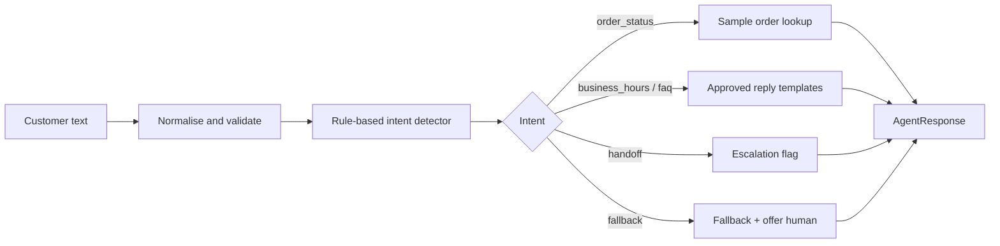

# AI Customer Calling Agent — Week 1 Prototype

A working, text-based prototype of the customer-support calling agent described in
`AI_Customer_Calling_Agent_Development_Plan.docx`. Week 1 delivers the decision
layer of the agent: it understands the customer's request, looks up approved
sample data, replies in short speakable sentences, and flags calls that need a
human representative.

**This is not a live phone agent yet.** No call is placed and no audio is
processed. Speech-to-text, text-to-speech and telephony arrive in Week 2.

---

## Week 1 status

| Week 1 requirement | Status |
| --- | --- |
| Requirements, use case and architecture documented | Done — `WEEK1_DEVELOPMENT_DOCUMENT.docx` |
| Local Python prototype with the five required intents | Done — verified by tests and demo |
| Unit tests including empty input, unknown questions, invalid order numbers | Done — 27 tests, all passing |
| First working test call | **Not done** — no telephony account, credentials or test number are available (see below) |
| Professional Week 1 Word document | Done |
| Clean, GitHub-ready structure | Done |

### Calling integration: honest status

The Week 1 roadmap expects a first test call. That step could not be completed
because this environment has no approved calling platform account, no API
credentials and no test phone number. Nothing in this repository claims
otherwise, and no secret keys are stored here.

The local prototype is the verified deliverable. To move to a real call, the
following access is required:

| Access needed | Purpose |
| --- | --- |
| Telephony account (e.g. Twilio, Telnyx, Plivo) | Place and receive calls |
| Account SID / auth token (stored as environment variables) | Authenticate API requests |
| One voice-capable phone number | Caller ID and inbound calls |
| One verified test destination number | Test calls on trial accounts |
| Public HTTPS webhook (e.g. ngrok during development) | Receive call events |
| Speech-to-text API key (e.g. Deepgram, Whisper) | Transcribe customer speech |
| Text-to-speech API key (e.g. ElevenLabs, Azure) | Speak the agent's replies |
| LLM API key (Week 2 dialogue engine) | Understand free-form speech |
| Client-approved recording notice, calling hours and Do-Not-Call policy | Compliance before any live call |

---

## Requirements

- Python 3.10 or newer (tested on Python 3.12.10)
- No third-party packages are needed to run the agent or the tests
- Optional tooling for the Word document: see `requirements-dev.txt`

## Project structure

```text
.
├── README.md
├── WEEK1_DEVELOPMENT_DOCUMENT.docx   # generated Week 1 report (black / dark-blue theme)
├── requirements.txt                  # runtime: standard library only
├── requirements-dev.txt              # pytest + python-docx
├── .gitignore
├── src/
│   ├── __init__.py
│   ├── agent.py                      # intents, validation, replies, escalation
│   ├── cli.py                        # simulated call in the terminal
│   └── sample_data.py                # clearly fictional orders, hours and FAQs
├── tests/
│   ├── __init__.py
│   └── test_agent.py                 # 27 unit tests
├── docs/
│   ├── WEEK1_DEVELOPMENT_DOCUMENT.md # source of the Word document
│   ├── test_results.txt              # real test output
│   └── demo_transcript.txt           # real demo output
└── scripts/
    └── build_week1_document.py       # regenerates the .docx from the .md
```

## Setup

Optional virtual environment (recommended, not required):

```bash
python -m venv .venv
# Windows PowerShell
.venv\Scripts\Activate.ps1
# macOS / Linux
source .venv/bin/activate
```

There are no runtime dependencies to install. For the optional test runner and
document builder:

```bash
pip install -r requirements-dev.txt
```

## Run the simulated call

From the project root:

```bash
python -m src.cli          # interactive chat
python -m src.cli --demo   # fixed sample conversation
```

Type `exit` or `quit`, or press Ctrl+C, to end the session. Each reply is shown
with the intent the agent detected, and escalations print a `[system]` line.
A full sample session is saved in `docs/demo_transcript.txt`.

## Run the tests

```bash
python -m unittest discover -s tests -t . -v
```

or, if pytest is installed:

```bash
python -m pytest -q
```

Expected result (28 October 2026, Python 3.12.10):

```text
Ran 27 tests in 0.004s

OK
```

Actual captured output: `docs/test_results.txt`.

## Supported intents

| Intent | Example the customer might say | Behaviour |
| --- | --- | --- |
| `greeting` | "Hello", "Assalam o Alaikum" | Greets, discloses AI assistant and recording notice |
| `order_status` | "Where is my order ORD-1001?", "1003" | Looks up the sample order, or asks for / corrects the number |
| `business_hours` | "What are your hours?", "Are you open on Sunday?" | Reads the grouped sample schedule |
| `faq` | "How long does delivery take?", "Return policy?" | Answers only from approved sample FAQ entries |
| `handoff` | "I want to speak to a human" | Sets `escalate=True` and explains the transfer |
| `fallback` | "Can you book me a flight?" | Says it cannot help, offers a human, no guessing |
| `goodbye` | "That's all, thank you" | Closes the call politely |
| `empty` | "" or whitespace | Asks the customer to repeat themselves |

Intent priority is explicit and tested: human handoff first, then order-related
requests, business hours, FAQs, greeting, goodbye, then fallback.

## How it works



`CustomerSupportAgent.handle_message()` is the public entry point. Week 2 will
wrap the same class with speech-to-text in front and text-to-speech behind, so
the dialogue logic does not need to be rewritten.

## Sample data warning

Everything in `src/sample_data.py` is fictional: orders `ORD-1001` to `ORD-1005`,
the "Sample Store Support" name, the 9 AM–6 PM hours and every FAQ answer. None
of it describes a real company or real customer. Replace it with client-approved
content (or a CRM/API) before any live call.

## Limitations

- Text only — no microphone, audio playback or telephony.
- Rule-based keyword matching, so unusual phrasing can fall back.
- No multi-turn memory beyond accepting a bare order number after prompting.
- No database writes, authentication, call logging or PII handling yet.
- No live interruption/barge-in handling (Week 2 speech pipeline work).
- English and a few greeting words only; full Urdu/English support is Week 2+.

## Next steps (Week 2)

1. Connect a telephony provider and a test number, then place the first real test call.
2. Add streaming speech-to-text and text-to-speech around `CustomerSupportAgent`.
3. Replace keyword rules with intent classification plus guardrails.
4. Load client-approved documents for FAQ retrieval.
5. Measure and tune response latency.


already excludes common secret and environment files.

