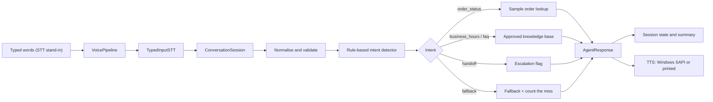
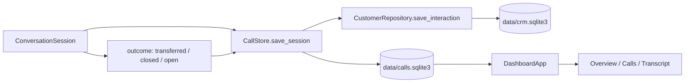

# AI Customer Calling Agent — Weeks 1–3

A working prototype of the customer-support calling agent described in
`AI_Customer_Calling_Agent_Development_Plan.docx`. Week 1 delivers the decision
layer of the agent: it understands the customer's request, looks up approved
sample data, replies in short speakable sentences, and flags calls that need a
human representative. Week 2 adds a call session with automatic escalation and
a local voice loop: typed words go in, and the reply is spoken through the
Windows voice (or printed when no voice is available). Week 3 connects a local
SQLite CRM and call log, saves every finished simulated call, and serves a
password-protected local dashboard with call logs, transcripts and analytics.

**This is not a live phone agent yet.** No phone line, microphone or
speech-recognition engine is connected. The "customer" text is typed or supplied
by the demo script; it is not a transcript of real audio. The CRM holds
fictional sample customers, and the dashboard shows the text transcript only —
there are no call recordings.

## Live demo

<https://ai-customer-calling-agent.vercel.app/> — a read-only hosted copy of the
demo. Demo login: `admin` / `week3-demo` (the password is already filled in on
the sign-in form).

The site covers the Weeks 1–3 build: an Overview with the Week 3 call log and
analytics, a Calls list with full transcripts, and a Journey tab that explains
what each project week delivered, how it was tested, and what is still blocked.
The data is fictional sample calls, and no telephony, CRM API or audio is
connected.

---

## Week 1 status

| Week 1 requirement | Status |
| --- | --- |
| Requirements, use case and architecture documented | Done — `WEEK1_DEVELOPMENT_DOCUMENT.docx` |
| Local Python prototype with the five required intents | Done — verified by tests and demo |
| Unit tests including empty input, unknown questions, invalid order numbers | Done — 27 tests, all passing |
| First working test call | **Not done** — no telephony account, credentials or test number are available (see below) |
| Professional Week 1 Word document | Done |
| Clean, GitHub-ready structure | Done |

### Calling integration: honest status

The Week 1 roadmap expects a first test call. That step could not be completed
because this environment has no approved calling platform account, no API
credentials and no test phone number. Nothing in this repository claims
otherwise, and no secret keys are stored here.

The local prototype is the verified deliverable. To move to a real call, the
following access is required:

| Access needed | Purpose |
| --- | --- |
| Telephony account (e.g. Twilio, Telnyx, Plivo) | Place and receive calls |
| Account SID / auth token (stored as environment variables) | Authenticate API requests |
| One voice-capable phone number | Caller ID and inbound calls |
| One verified test destination number | Test calls on trial accounts |
| Public HTTPS webhook (e.g. ngrok during development) | Receive call events |
| Speech-to-text API key (e.g. Deepgram, Whisper) | Transcribe customer speech |
| Text-to-speech API key (e.g. ElevenLabs, Azure) | Speak the agent's replies |
| LLM API key (Week 2 dialogue engine) | Understand free-form speech |
| Client-approved recording notice, calling hours and Do-Not-Call policy | Compliance before any live call |

---

## Week 2 status

Week 2 in the plan is about building the conversation engine. The parts that do
not depend on external accounts are implemented and tested; the parts that need
a speech or telephony provider are still blocked by the same missing access
listed above.

| Week 2 item | Status |
| --- | --- |
| Knowledge base with validated, approved FAQ entries | Done — `src/knowledge_base.py`, 14 tests |
| Call session with a 3-strike fallback escalation and handoff summary | Done — `src/session.py`, 12 tests |
| Voice loop with pluggable speech-to-text and text-to-speech interfaces | Done — `src/voice/` |
| Spoken replies | Done locally — Windows SAPI via PowerShell (2 voices detected on this machine); no API key needed |
| Streaming speech-to-text / microphone input | **Not done** — no STT account or credentials |
| Telephony test call, barge-in, latency measurement | **Not done** — no phone number, telephony account or audio stream |
| Week 2 Word report | Done — `WEEK2_DEVELOPMENT_DOCUMENT.docx` (same theme as Week 1) |
| Tests and README updated for Week 2 | Done — 65 tests, 0 failures |

What "spoken replies" means here: the agent's approved text is read aloud by the
laptop's built-in Windows voice. It is not a telephony voice, and nothing is
recorded or uploaded. If the Windows voice is unavailable, the same text is
printed instead. No audio was played automatically during development; run the
demo yourself to hear it.

---

## Week 3 status

Week 3 in the plan is about connecting a business system and giving the team a
way to see what the agent did. No client CRM, API credentials or telephony
account exist in this environment, so the integration is a local SQLite
stand-in with fictional records. The dashboard and the logging are real and
working; the customer data is not.

| Week 3 item | Status |
| --- | --- |
| Local CRM: customers, orders and interactions in SQLite | Done — `src/crm.py`, fictional seed data, 10 tests |
| Call log with transcript, outcome and caller link | Done — `src/call_store.py`, 10 tests |
| Analytics: call counts, escalation rate, average turns, intents, calls per day | Done — used by the dashboard overview |
| Demo saves each finished call to the CRM and call log | Done — `python -m src.voice.demo` prints `Call #N saved locally` |
| Admin dashboard: login, overview, call list with filters, transcript detail | Done — `src/dashboard/`, 19 tests |
| Dashboard security | Local-only: loopback binding, password login, HttpOnly + SameSite=Strict session cookie, escaped HTML, 4 KB request limit |
| Call recordings / audio playback | **Not done** — no telephony or audio capture is connected; the dashboard says so explicitly |
| Real CRM or client API integration | **Not done** — needs client API access; the local schema is a stand-in |
| Week 3 Word report | Done — `WEEK3_DEVELOPMENT_DOCUMENT.docx` (same theme as Weeks 1 and 2) |
| Hosted static demo of the dashboard | Done — `web/`, deployed on Vercel, fictional data, client-side demo gate |
| Tests and README updated for Week 3 | Done — 104 tests, 0 failures |

The database files live in `data/` and are ignored by git. Delete them to start
fresh; they are recreated (customers and orders are reseeded, calls are not).

---

## Requirements

- Python 3.10 or newer (tested on Python 3.12.10)
- No third-party packages are needed to run the agent, the session or the tests
- Spoken output uses the built-in Windows voice (available on this Windows 10/11
  machine); on other systems the demo prints replies instead
- Optional tooling for the Week 1 Word document: see `requirements-dev.txt`

## Project structure

```text
.
├── README.md
├── WEEK1_DEVELOPMENT_DOCUMENT.docx   # generated Week 1 report (black / dark-blue theme)
├── WEEK2_DEVELOPMENT_DOCUMENT.docx   # generated Week 2 report (same theme)
├── WEEK3_DEVELOPMENT_DOCUMENT.docx   # generated Week 3 report (same theme)
├── requirements.txt                  # runtime: standard library only
├── requirements-dev.txt              # pytest + python-docx
├── .gitignore
├── src/
│   ├── __init__.py
│   ├── agent.py                      # intents, validation, replies, escalation
│   ├── knowledge_base.py             # Week 2: validated FAQ entries + lookup
│   ├── session.py                    # Week 2: call state, 3-strike escalation, summary
│   ├── crm.py                        # Week 3: local SQLite CRM (fictional data)
│   ├── call_store.py                 # Week 3: call log, transcripts, analytics
│   ├── cli.py                        # Week 1: simulated text call in the terminal
│   ├── sample_data.py                # clearly fictional orders, hours and FAQs
│   ├── dashboard/                    # Week 3: local admin dashboard
│   │   ├── __init__.py
│   │   ├── __main__.py               # python -m src.dashboard
│   │   ├── app.py                    # routing, login, session cookie, HTTP server
│   │   └── views.py                  # HTML pages and inline stylesheet
│   └── voice/                        # Week 2: voice loop
│       ├── __init__.py
│       ├── pipeline.py               # STT -> session -> TTS, pluggable protocols
│       ├── stt.py                    # typed-input STT stand-in (no microphone)
│       ├── tts.py                    # Windows SAPI voice + printed fallback
│       └── demo.py                   # simulated call; saves finished calls
├── data/                             # local SQLite files, ignored by git (created on first run)
├── web/                              # Week 3 static dashboard demo (deployed on Vercel)
│   ├── index.html
│   ├── styles.css
│   └── app.js                        # sample data, routing, views, demo gate
├── tests/
│   ├── __init__.py
│   ├── test_agent.py                 # 27 Week 1 tests
│   ├── test_knowledge_base.py        # 14 Week 2 tests
│   ├── test_session.py               # 12 Week 2 tests
│   ├── test_voice_pipeline.py        # 12 Week 2 tests
│   ├── test_crm.py                   # 10 Week 3 tests
│   ├── test_call_store.py            # 10 Week 3 tests
│   └── test_dashboard.py             # 19 Week 3 tests
├── docs/
│   ├── WEEK1_DEVELOPMENT_DOCUMENT.md # source of the Week 1 Word document
│   ├── WEEK2_DEVELOPMENT_DOCUMENT.md # source of the Week 2 Word document
│   ├── WEEK3_DEVELOPMENT_DOCUMENT.md # source of the Week 3 Word document
│   ├── test_results.txt              # real Week 1 test output
│   ├── week2_test_results.txt        # real Week 2 test output (65 tests)
│   ├── week3_test_results.txt        # real Week 3 test output (104 tests)
│   ├── demo_transcript.txt           # real Week 1 demo output
│   ├── week2_demo_transcript.txt     # real Week 2 demo output
│   ├── week3_demo_transcript.txt     # real Week 3 demo output (call saved to SQLite)
│   ├── week3_dashboard_check.txt     # real dashboard HTTP check output (19/19)
│   └── week3_deploy_check.txt        # static site local checks and published address
└── scripts/
    ├── build_week1_document.py       # shared theme builder; regenerates the Week 1 .docx
    ├── build_week2_document.py       # regenerates the Week 2 .docx
    ├── build_week3_document.py       # regenerates the Week 3 .docx
    └── check_week3_dashboard.py      # starts a loopback dashboard and verifies every page
```

## Setup

Optional virtual environment (recommended, not required):

```bash
python -m venv .venv
# Windows PowerShell
.venv\Scripts\Activate.ps1
# macOS / Linux
source .venv/bin/activate
```

There are no runtime dependencies to install. For the optional test runner and
document builder:

```bash
pip install -r requirements-dev.txt
```

## Run the simulated call

From the project root:

```bash
python -m src.cli          # interactive chat
python -m src.cli --demo   # fixed sample conversation
```

Type `exit` or `quit`, or press Ctrl+C, to end the session. Each reply is shown
with the intent the agent detected, and escalations print a `[system]` line.
A full sample session is saved in `docs/demo_transcript.txt`.

### Week 2: simulated voice call

```bash
python -m src.voice.demo               # fixed conversation, spoken through the Windows voice
python -m src.voice.demo --silent      # same conversation, printed only
python -m src.voice.demo --interactive # type customer lines yourself
```

The Week 2 demo adds the call session and the voice loop. Customer lines are
typed or supplied by the script — this is the stand-in for speech-to-text until
an STT engine is connected. Replies are read aloud locally by Windows SAPI; in
`--silent` mode they are printed as `[voice] ...` lines instead. The fixed
conversation deliberately includes three unknown requests in a row, so you can
see the agent escalate to a human by itself. The real captured output is in
`docs/week2_demo_transcript.txt`.

Since Week 3, a finished simulated call is also written to the local CRM and
call log. Add `--caller` to choose which fictional customer is calling:

```bash
python -m src.voice.demo --silent --caller 0300-0000002
```

The default caller is `0300-0000001` (Sample Customer A). The console ends with
`[system] Call #N saved locally (...)` and the dashboard can then show the call.
The captured Week 3 run is in `docs/week3_demo_transcript.txt`.

No audio is recorded, no phone number is dialled and no data leaves the machine.

### Week 3: local admin dashboard

```bash
# Windows PowerShell: choose a password for this session
$env:DASHBOARD_PASSWORD = "change-me"
python -m src.dashboard

# Git Bash / macOS / Linux
DASHBOARD_PASSWORD="change-me" python -m src.dashboard
```

Open <http://127.0.0.1:8080/>, sign in as `admin` with that password, and the
dashboard shows:

- **Overview** — total calls, calls transferred to a human, escalation rate and
  average turns, plus recent calls, outcomes, intent counts and calls per day.
- **Calls** — every saved call, newest first, filterable by outcome.
- **Call detail** — caller, linked customer, outcome, handoff summary and the
  full text transcript. The page states that recordings are not available.

If `DASHBOARD_PASSWORD` is not set, a random one-time password is printed in the
terminal. Use `--port` to change the port and `--host` only if you understand
the warning the server prints.

This is a local demonstration tool, not production authentication: no TLS, no
user database, no multi-user permissions, and the login session lives in memory
so restarting the server signs everyone out. Bind it to `127.0.0.1` and use it
with fictional data only. Run `python -m scripts.check_week3_dashboard` to start
a temporary dashboard and verify login, pages, filters, escaping and logout over
real HTTP (captured output: `docs/week3_dashboard_check.txt`).

### Hosted dashboard demo

`web/` is a static, read-only publication of the same dashboard views for
sharing screenshots or a quick demo:

```bash
python -m http.server 8090 --bind 127.0.0.1 --directory web
# open http://127.0.0.1:8090/  (demo passcode: week3-demo)
```

Published copy: <https://ai-customer-calling-agent.vercel.app/>. The site
contains fictional sample calls; call #1 is the captured Week 3 demo transcript.
The sign-in is a client-side demo gate, not real authentication, and the site
has no backend, CRM API, telephony or audio. Local checks are recorded in
`docs/week3_deploy_check.txt`.

The published copy is public: the URL opens in any browser, and the demo
passcode is filled in on the sign-in form.

### Deploy the static demo on Vercel

`vercel.json` at the repository root turns off framework auto-detection so the
static files are served as-is. Connect the repository at
<https://vercel.com/new>, or deploy the `web` folder directly:

```bash
cd web
npx vercel --prod
```

The Python dashboard, SQLite call log and CRM do **not** run on Vercel — only
the static demo does. Either way the demo passcode stays `week3-demo`.

### Rebuild the Week 2 report

```bash
pip install -r requirements-dev.txt
python scripts/build_week2_document.py
```

The Markdown in `docs/WEEK2_DEVELOPMENT_DOCUMENT.md` is the editable source; the
script applies the same black and dark-blue theme as the Week 1 report.

### Rebuild the Week 3 report

```bash
pip install -r requirements-dev.txt
python scripts/build_week3_document.py
```

Source: `docs/WEEK3_DEVELOPMENT_DOCUMENT.md`. Output:
`WEEK3_DEVELOPMENT_DOCUMENT.docx` (30 tables, same theme).

## Run the tests

```bash
python -m unittest discover -s tests -t . -v
```

or, if pytest is installed:

```bash
python -m pytest -q
```

Expected result (2 November 2026, Python 3.12.10):

```text
Ran 104 tests in 5.1s

OK
```

That is the 27 Week 1 tests, 38 Week 2 tests (knowledge base, session, voice
pipeline) and 39 Week 3 tests (CRM, call store, dashboard), including the
HTTP-level dashboard checks. Actual captured output: `docs/week3_test_results.txt`;
earlier runs are kept in `docs/week2_test_results.txt` and `docs/test_results.txt`.

## Supported intents

| Intent | Example the customer might say | Behaviour |
| --- | --- | --- |
| `greeting` | "Hello", "Assalam o Alaikum" | Greets, discloses AI assistant and recording notice |
| `order_status` | "Where is my order ORD-1001?", "1003" | Looks up the sample order, or asks for / corrects the number |
| `business_hours` | "What are your hours?", "Are you open on Sunday?" | Reads the grouped sample schedule |
| `faq` | "How long does delivery take?", "Return policy?" | Answers only from approved sample FAQ entries |
| `handoff` | "I want to speak to a human" | Sets `escalate=True` and explains the transfer |
| `fallback` | "Can you book me a flight?" | Says it cannot help, offers a human, no guessing |
| `goodbye` | "That's all, thank you" | Closes the call politely |
| `empty` | "" or whitespace | Asks the customer to repeat themselves |

Intent priority is explicit and tested: human handoff first, then order-related
requests, business hours, FAQs, greeting, goodbye, then fallback.

### Escalation across a call (Week 2)

`ConversationSession` counts consecutive turns the agent failed to understand
(`fallback` or silence). After three in a row it replaces the reply with a
handoff and sets `escalate=True`, so the customer is not stuck in a loop. A
successful turn resets the counter, and a handoff the customer asked for is not
escalated twice. `session.summary()` produces a one-line note — topics and
outcome — for the human who receives the transfer.

## How it works



`CustomerSupportAgent.handle_message()` remains the single decision entry point.
`ConversationSession.handle()` adds per-call memory and escalation, and
`VoicePipeline.handle_audio()` runs speech in, session, speech out. Week 1's
`src.cli` still uses the agent directly.

Week 3 closes the loop after the call:



The caller number is matched to a fictional customer with `normalize_phone`,
so `0300-0000001`, `0300 0000001`, `03000000001` and `+92 300 0000001` all find
Sample Customer A. The dashboard reads only from the call store; it never writes
customer data.

## Sample data warning

Everything in `src/sample_data.py` is fictional: orders `ORD-1001` to `ORD-1005`,
the "Sample Store Support" name, the 9 AM–6 PM hours and every FAQ answer. The
Week 3 CRM seed (`src/crm.py`) is also fictional: `Sample Customer A` to
`Sample Customer E`, phone numbers `0300-0000001` to `0300-0000005`, and
`@example.test` email addresses. None of it describes a real company or real
customer. Replace it with client-approved content (or a CRM/API) before any live
call.

## Limitations

- Customer input is typed, not spoken — no microphone, streaming STT or audio
  capture is connected.
- Spoken output is the local Windows voice, not a telephony voice; barge-in
  (customer interrupting the agent) needs a real audio stream and is not done.
- Response latency has not been measured against the 1.5-second target.
- Rule-based keyword matching, so unusual phrasing can fall back.
- The CRM and call log are local SQLite stand-ins with fictional data; no client
  CRM/API is connected and no PII handling or retention policy is implemented.
- The dashboard is a local demo: single hard-coded username, password from an
  environment variable, in-memory session, no TLS, no user management. Do not
  expose it to a network or point it at real customer data.
- There are no call recordings and no audio playback because there is no
  telephony or audio capture.
- English and a few greeting words only; full Urdu/English support is later.

## Next steps (Week 4)

1. Connect a telephony provider and test number, then place the first real test
   call — still blocked until the access in the table above is provided.
2. Replace typed input with streaming speech-to-text and the Windows voice with
   a telephony voice; handle barge-in and measure end-to-end latency.
3. Replace the local SQLite CRM with the client's approved CRM/API, keeping the
   same repository methods so callers do not change.
4. Run a small supervised pilot, review transcripts in the dashboard, and tune
   the rules and knowledge base from real (consented) conversations.
5. Add proper authentication, HTTPS and retention rules before the dashboard
   leaves localhost.

## Adding this to GitHub

Copy the files above into the root of your existing repository (or this folder if
you plan to initialise one). Nothing in your existing repository was modified by
this work, and the original plan document in Downloads was left untouched.

Week 1 commit:

```bash
git status
git add README.md .gitignore requirements.txt requirements-dev.txt \
        src tests docs scripts WEEK1_DEVELOPMENT_DOCUMENT.docx
git commit -m "Week 1: working customer support agent prototype with tests"
```

Week 2 commit (after the Week 1 files are in the repository):

```bash
git status
git add src/knowledge_base.py src/session.py src/voice \
        tests/test_knowledge_base.py tests/test_session.py tests/test_voice_pipeline.py \
        docs/WEEK2_DEVELOPMENT_DOCUMENT.md docs/week2_test_results.txt \
        docs/week2_demo_transcript.txt scripts/build_week1_document.py \
        scripts/build_week2_document.py WEEK2_DEVELOPMENT_DOCUMENT.docx README.md
git commit -m "Week 2: call session, knowledge base and local voice loop"
```

Week 3 commit (after Week 2):

```bash
git status
git add src/crm.py src/call_store.py src/dashboard src/session.py src/voice/demo.py \
        tests/test_crm.py tests/test_call_store.py tests/test_dashboard.py \
        scripts/check_week3_dashboard.py scripts/build_week3_document.py .gitignore README.md \
        web docs/WEEK3_DEVELOPMENT_DOCUMENT.md docs/week3_test_results.txt \
        docs/week3_demo_transcript.txt docs/week3_dashboard_check.txt \
        docs/week3_deploy_check.txt WEEK3_DEVELOPMENT_DOCUMENT.docx
git commit -m "Week 3: local CRM, call log and admin dashboard"
```

`data/` is ignored on purpose: the SQLite files are rebuilt on the next run and
must never carry customer data into the repository. If the Week 1 or Week 2
commit already included whole folders, use `git status` to confirm exactly which
paths changed before adding.

Keep `.env` files, tokens and phone numbers out of the repository; `.gitignore`
already excludes common secret and environment files.


