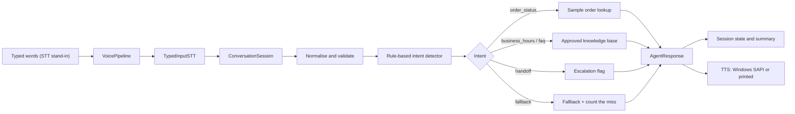
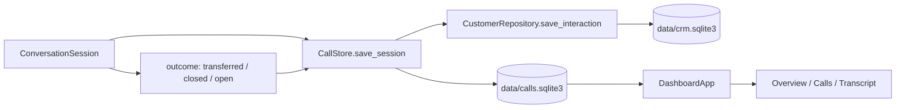

# AI Customer Calling Agent

A working prototype of the customer-support calling agent described in
`AI_Customer_Calling_Agent_Development_Plan.docx`. Week 1 delivers the decision
layer of the agent: it understands the customer's request, looks up approved
sample data, replies in short speakable sentences, and flags calls that need a
human representative. Week 2 adds a call session with automatic escalation and
a local voice loop: typed words go in, and the reply is spoken through the
Windows voice (or printed when no voice is available). Week 3 connects a local
SQLite CRM and call log, saves every finished simulated call, and serves a
password-protected local dashboard with call logs, transcripts and analytics.

**No phone line is connected.** A real browser voice agent is now built: Vapi
handles the microphone, speech recognition, the language model and the spoken
reply, and every finished web call is saved through the Vercel API to a hosted
Supabase Postgres database. The live call is not claimed as verified until the
Vercel environment keys are set and the test calls below are run.

The earlier Weeks 1–3 prototype still holds the approved order and FAQ data,
the three-strike escalation rule and the call-log format. Its CRM holds fictional
sample customers, and the dashboard shows text transcripts only — there are no
call recordings.

Weeks 1–3 of the four-week plan are delivered and tested (104 automated tests).
Week 4 work is being added in the order: live web call, language and barge-in,
authentication and hosted data, appointments, outbound calling, then KPIs and
reports. See [Live voice agent (Step A)](#live-voice-agent-step-a).

## Live project website

<https://ai-customer-calling-agent.vercel.app/> — a public, read-only copy of
the project website. No sign-in is required.

The site presents the whole Weeks 1–3 build across seven views (labelled
Stage 1–3 on the site):

- **Home** — what the agent does, how a call flows, and what works versus what
  still needs external access.
- **Dashboard** — total calls, escalation rate, average turns, outcomes, intents
  and calls per day, calculated from the sample call log.
- **Call log** and **call detail** — 12 sample calls with outcomes, customer
  links and full text transcripts.
- **Journey** — what each stage delivered, how it was tested, the access still
  missing and the next steps.
- **How it works** — the eight intents, escalation and handoff logic, the data
  model and the dashboard's security measures.
- **Testing** — seven suites, 104 tests, captured evidence and the three weekly
  reports as DOCX downloads.

All customer names, orders and sample calls are fictional; call #1 reproduces
the captured Week 3 demo run. Live web calls are shown separately and labelled
**Live call**. With no Vapi or Supabase keys in the hosting environment, the
live panel says so and the rest of the site keeps working from sample data.

---

## Live voice agent (Step A)

The website can start a real browser call with a microphone. Vapi runs speech
recognition (Deepgram), the assistant model (OpenAI) and text-to-speech, then
calls the same backend that holds the approved order and FAQ data. When the call
ends, the transcript, summary, duration and outcome are written to Supabase and
appear in the dashboard.

### Files

| File | Purpose |
| --- | --- |
| `supabase/schema.sql` | Tables `orders`, `faqs`, `live_calls`, `handoffs`, `settings`, plus sample orders and FAQs |
| `web/api/config.js` | Returns the Vapi public key and assistant id to the browser |
| `web/api/setup.js` | Creates or updates the Vapi assistant (token-protected) and stores its id |
| `web/api/vapi.js` | Vapi webhook: tool calls and end-of-call reports, with secret verification |
| `web/api/calls.js` | Reads live calls for the dashboard and call detail |
| `web/api/_assistant.js` | ShopEasy/Sumyia first message, system prompt and tool definitions |
| `web/api/_lib.js` | Supabase REST helper, response helper and card/CNIC masking |
| `web/app.js` | "Talk to the agent" button, browser call dock and live-call views |
| `scripts/check_live_api.js` | Offline check of all endpoints with stubbed Supabase and Vapi |

### Setup order

1. **Supabase** — create a free project, open the SQL editor, paste and run
   `supabase/schema.sql`. Copy the project URL and the `service_role` key from
   Project Settings → API.
2. **Vapi** — create an account and copy the private API key and the public key
   from the dashboard. No assistant needs to be created by hand;
   `web/api/setup.js` creates it.
3. **Vercel environment variables** — add these to the project (Production and
   Preview), never to the repository:

   | Variable | Where it comes from |
   | --- | --- |
   | `VAPI_PUBLIC_KEY` | Vapi dashboard, public key |
   | `VAPI_PRIVATE_KEY` | Vapi dashboard, private key |
   | `VAPI_SERVER_SECRET` | Any long random string you generate; Vapi sends it back in `X-Vapi-Secret` |
   | `SETUP_TOKEN` | Any long random string; protects the one-time setup endpoint |
   | `SUPABASE_URL` | Supabase project URL |
   | `SUPABASE_SERVICE_ROLE_KEY` | Supabase `service_role` key (server only) |
   | `VAPI_ASSISTANT_ID` | Optional. Filled automatically by setup into `settings` |

4. **Deploy on Vercel.** The project is connected to GitHub `main` and serves the
   repository root as a flat site: `index.html`, `styles.css` and `app.js` at the
   top level, with the functions in `api/`. Upload the changed files to `main`
   (or drop `vercel-upload.zip` on the project) and Vercel rebuilds
   `https://ai-customer-calling-agent.vercel.app/`.

5. **Create the assistant once** after the first deployment:

   ```bash
   curl -X POST https://ai-customer-calling-agent.vercel.app/api/setup \
     -H "x-setup-token: YOUR_SETUP_TOKEN"
   ```

   The response contains the assistant id. Re-running the same request updates
   the assistant.

6. **Make a call** — open the site, press **Talk to the agent**, allow the
   microphone, and try `Where is order ORD-1002?`. End the call and wait a few
   seconds; the row appears under **Live calls** with its transcript.

If Vapi rejects the browser origin, add the deployed domain to the allowed
origins for the public key in the Vapi dashboard.

### Offline checks

These do not need any account or key:

```bash
node scripts/check_live_api.js
```

The script stubs Supabase and the Vapi assistant API and checks 18 cases:
configuration, setup token, assistant create/update, webhook secret, order found
and not found, FAQ hit and miss, business hours, handoff, outcome logging,
invalid outcome, end-of-call save, duration, card masking, and call list/detail.
Captured output: `docs/step_a_api_check.txt`.

### What Step A does not include

- **No phone number.** Calls are browser web calls only.
- **English only.** Deepgram is configured for English; Urdu and mixed-language
  speech are Step B and are not claimed as working.
- **Barge-in is available through Vapi but not tuned or measured yet.** The
  latency target of about 1.5 seconds will be measured in Step B.
- **No identity check yet.** Order status uses sample orders and exposes no
  personal details; the order-ID-plus-name check is Step B.
- **Prompt-injection resistance is written into the system prompt but not tested**
  with adversarial calls yet; that test is Step F.
- **The live-call API is public** for Step A. Server-side login with `admin` and
  `viewer` roles is Step C; until then, do not put real customer data in it.
- **No audio is stored.** Only transcript and summary are saved, and card/CNIC
  patterns are masked before saving.
- **No appointments or outbound calling yet.** Steps D and E add them.

---

## Week 1 status

| Week 1 requirement | Status |
| --- | --- |
| Requirements, use case and architecture documented | Done — `WEEK1_DEVELOPMENT_DOCUMENT.docx` |
| Local Python prototype with the five required intents | Done — verified by tests and demo |
| Unit tests including empty input, unknown questions, invalid order numbers | Done — 27 tests, all passing |
| First working test call | **Not done** — no telephony account, credentials or test number are available (see below) |
| Professional Week 1 Word document | Done |
| Clean, GitHub-ready structure | Done |

### Calling integration: honest status

The Week 1 roadmap expects a first test call. That step could not be completed
because this environment has no approved calling platform account, no API
credentials and no test phone number. Nothing in this repository claims
otherwise, and no secret keys are stored here.

The local prototype is the verified deliverable. To move to a real call, the
following access is required:

| Access needed | Purpose |
| --- | --- |
| Telephony account (e.g. Twilio, Telnyx, Plivo) | Place and receive calls |
| Account SID / auth token (stored as environment variables) | Authenticate API requests |
| One voice-capable phone number | Caller ID and inbound calls |
| One verified test destination number | Test calls on trial accounts |
| Public HTTPS webhook (e.g. ngrok during development) | Receive call events |
| Speech-to-text API key (e.g. Deepgram, Whisper) | Transcribe customer speech |
| Text-to-speech API key (e.g. ElevenLabs, Azure) | Speak the agent's replies |
| LLM API key (Week 2 dialogue engine) | Understand free-form speech |
| Client-approved recording notice, calling hours and Do-Not-Call policy | Compliance before any live call |

---

## Week 2 status

Week 2 in the plan is about building the conversation engine. The parts that do
not depend on external accounts are implemented and tested; the parts that need
a speech or telephony provider are still blocked by the same missing access
listed above.

| Week 2 item | Status |
| --- | --- |
| Knowledge base with validated, approved FAQ entries | Done — `src/knowledge_base.py`, 14 tests |
| Call session with a 3-strike fallback escalation and handoff summary | Done — `src/session.py`, 12 tests |
| Voice loop with pluggable speech-to-text and text-to-speech interfaces | Done — `src/voice/` |
| Spoken replies | Done locally — Windows SAPI via PowerShell (2 voices detected on this machine); no API key needed |
| Streaming speech-to-text / microphone input | **Not done** — no STT account or credentials |
| Telephony test call, barge-in, latency measurement | **Not done** — no phone number, telephony account or audio stream |
| Week 2 Word report | Done — `WEEK2_DEVELOPMENT_DOCUMENT.docx` (same theme as Week 1) |
| Tests and README updated for Week 2 | Done — 65 tests, 0 failures |

What "spoken replies" means here: the agent's approved text is read aloud by the
laptop's built-in Windows voice. It is not a telephony voice, and nothing is
recorded or uploaded. If the Windows voice is unavailable, the same text is
printed instead. No audio was played automatically during development; run the
demo yourself to hear it.

---

## Week 3 status

Week 3 in the plan is about connecting a business system and giving the team a
way to see what the agent did. No client CRM, API credentials or telephony
account exist in this environment, so the integration is a local SQLite
stand-in with fictional records. The dashboard and the logging are real and
working; the customer data is not.

| Week 3 item | Status |
| --- | --- |
| Local CRM: customers, orders and interactions in SQLite | Done — `src/crm.py`, fictional seed data, 10 tests |
| Call log with transcript, outcome and caller link | Done — `src/call_store.py`, 10 tests |
| Analytics: call counts, escalation rate, average turns, intents, calls per day | Done — used by the dashboard overview |
| Demo saves each finished call to the CRM and call log | Done — `python -m src.voice.demo` prints `Call #N saved locally` |
| Admin dashboard: login, overview, call list with filters, transcript detail | Done — `src/dashboard/`, 19 tests |
| Dashboard security | Local-only: loopback binding, password login, HttpOnly + SameSite=Strict session cookie, escaped HTML, 4 KB request limit |
| Call recordings / audio playback | **Not done** — no telephony or audio capture is connected; the dashboard says so explicitly |
| Real CRM or client API integration | **Not done** — needs client API access; the local schema is a stand-in |
| Outbound calling campaigns, calendar booking and identity verification | **Not done** — the delivered MVP is inbound-only; these plan items need telephony, client systems and approved policy |
| Week 3 Word report | Done — `WEEK3_DEVELOPMENT_DOCUMENT.docx` (same theme as Weeks 1 and 2) |
| Hosted project website | Done — `web/`, public on Vercel, seven views, no sign-in, fictional data |
| Tests and README updated for Week 3 | Done — 104 tests, 0 failures |

The database files live in `data/` and are ignored by git. Delete them to start
fresh; they are recreated (customers and orders are reseeded, calls are not).

---

## Requirements

- Python 3.10 or newer (tested on Python 3.12.10)
- No third-party packages are needed to run the agent, the session or the tests
- Spoken output uses the built-in Windows voice (available on this Windows 10/11
  machine); on other systems the demo prints replies instead
- Optional tooling for the Week 1 Word document: see `requirements-dev.txt`

## Project structure

```text
.
├── README.md
├── WEEK1_DEVELOPMENT_DOCUMENT.docx   # generated Week 1 report (black / dark-blue theme)
├── WEEK2_DEVELOPMENT_DOCUMENT.docx   # generated Week 2 report (same theme)
├── WEEK3_DEVELOPMENT_DOCUMENT.docx   # generated Week 3 report (same theme)
├── requirements.txt                  # runtime: standard library only
├── requirements-dev.txt              # pytest + python-docx
├── .gitignore
├── src/
│   ├── __init__.py
│   ├── agent.py                      # intents, validation, replies, escalation
│   ├── knowledge_base.py             # Week 2: validated FAQ entries + lookup
│   ├── session.py                    # Week 2: call state, 3-strike escalation, summary
│   ├── crm.py                        # Week 3: local SQLite CRM (fictional data)
│   ├── call_store.py                 # Week 3: call log, transcripts, analytics
│   ├── cli.py                        # Week 1: simulated text call in the terminal
│   ├── sample_data.py                # clearly fictional orders, hours and FAQs
│   ├── dashboard/                    # Week 3: local admin dashboard
│   │   ├── __init__.py
│   │   ├── __main__.py               # python -m src.dashboard
│   │   ├── app.py                    # routing, login, session cookie, HTTP server
│   │   └── views.py                  # HTML pages and inline stylesheet
│   └── voice/                        # Week 2: voice loop
│       ├── __init__.py
│       ├── pipeline.py               # STT -> session -> TTS, pluggable protocols
│       ├── stt.py                    # typed-input STT stand-in (no microphone)
│       ├── tts.py                    # Windows SAPI voice + printed fallback
│       └── demo.py                   # simulated call; saves finished calls
├── data/                             # local SQLite files, ignored by git (created on first run)
├── web/                              # public static project website (deployed on Vercel)
│   ├── index.html
│   ├── styles.css
│   ├── app.js                        # sample data, routing and every view
│   ├── WEEK1_DEVELOPMENT_DOCUMENT.docx
│   ├── WEEK2_DEVELOPMENT_DOCUMENT.docx
│   └── WEEK3_DEVELOPMENT_DOCUMENT.docx
├── tests/
│   ├── __init__.py
│   ├── test_agent.py                 # 27 Week 1 tests
│   ├── test_knowledge_base.py        # 14 Week 2 tests
│   ├── test_session.py               # 12 Week 2 tests
│   ├── test_voice_pipeline.py        # 12 Week 2 tests
│   ├── test_crm.py                   # 10 Week 3 tests
│   ├── test_call_store.py            # 10 Week 3 tests
│   └── test_dashboard.py             # 19 Week 3 tests
├── docs/
│   ├── WEEK1_DEVELOPMENT_DOCUMENT.md # source of the Week 1 Word document
│   ├── WEEK2_DEVELOPMENT_DOCUMENT.md # source of the Week 2 Word document
│   ├── WEEK3_DEVELOPMENT_DOCUMENT.md # source of the Week 3 Word document
│   ├── test_results.txt              # real Week 1 test output
│   ├── week2_test_results.txt        # real Week 2 test output (65 tests)
│   ├── week3_test_results.txt        # real Week 3 test output (104 tests)
│   ├── demo_transcript.txt           # real Week 1 demo output
│   ├── week2_demo_transcript.txt     # real Week 2 demo output
│   ├── week3_demo_transcript.txt     # real Week 3 demo output (call saved to SQLite)
│   ├── week3_dashboard_check.txt     # real dashboard HTTP check output (19/19)
│   └── week3_deploy_check.txt        # static site local checks and published address
└── scripts/
    ├── build_week1_document.py       # shared theme builder; regenerates the Week 1 .docx
    ├── build_week2_document.py       # regenerates the Week 2 .docx
    ├── build_week3_document.py       # regenerates the Week 3 .docx
    └── check_week3_dashboard.py      # starts a loopback dashboard and verifies every page
```

## Setup

Optional virtual environment (recommended, not required):

```bash
python -m venv .venv
# Windows PowerShell
.venv\Scripts\Activate.ps1
# macOS / Linux
source .venv/bin/activate
```

There are no runtime dependencies to install. For the optional test runner and
document builder:

```bash
pip install -r requirements-dev.txt
```

## Run the simulated call

From the project root:

```bash
python -m src.cli          # interactive chat
python -m src.cli --demo   # fixed sample conversation
```

Type `exit` or `quit`, or press Ctrl+C, to end the session. Each reply is shown
with the intent the agent detected, and escalations print a `[system]` line.
A full sample session is saved in `docs/demo_transcript.txt`.

### Week 2: simulated voice call

```bash
python -m src.voice.demo               # fixed conversation, spoken through the Windows voice
python -m src.voice.demo --silent      # same conversation, printed only
python -m src.voice.demo --interactive # type customer lines yourself
```

The Week 2 demo adds the call session and the voice loop. Customer lines are
typed or supplied by the script — this is the stand-in for speech-to-text until
an STT engine is connected. Replies are read aloud locally by Windows SAPI; in
`--silent` mode they are printed as `[voice] ...` lines instead. The fixed
conversation deliberately includes three unknown requests in a row, so you can
see the agent escalate to a human by itself. The real captured output is in
`docs/week2_demo_transcript.txt`.

Since Week 3, a finished simulated call is also written to the local CRM and
call log. Add `--caller` to choose which fictional customer is calling:

```bash
python -m src.voice.demo --silent --caller 0300-0000002
```

The default caller is `0300-0000001` (Sample Customer A). The console ends with
`[system] Call #N saved locally (...)` and the dashboard can then show the call.
The captured Week 3 run is in `docs/week3_demo_transcript.txt`.

No audio is recorded, no phone number is dialled and no data leaves the machine.

### Week 3: local admin dashboard

```bash
# Windows PowerShell: choose a password for this session
$env:DASHBOARD_PASSWORD = "change-me"
python -m src.dashboard

# Git Bash / macOS / Linux
DASHBOARD_PASSWORD="change-me" python -m src.dashboard
```

Open <http://127.0.0.1:8080/>, sign in as `admin` with that password, and the
dashboard shows:

- **Overview** — total calls, calls transferred to a human, escalation rate and
  average turns, plus recent calls, outcomes, intent counts and calls per day.
- **Calls** — every saved call, newest first, filterable by outcome.
- **Call detail** — caller, linked customer, outcome, handoff summary and the
  full text transcript. The page states that recordings are not available.

If `DASHBOARD_PASSWORD` is not set, a random one-time password is printed in the
terminal. Use `--port` to change the port and `--host` only if you understand
the warning the server prints.

This is a local demonstration tool, not production authentication: no TLS, no
user database, no multi-user permissions, and the login session lives in memory
so restarting the server signs everyone out. Bind it to `127.0.0.1` and use it
with fictional data only. Run `python -m scripts.check_week3_dashboard` to start
a temporary dashboard and verify login, pages, filters, escaping and logout over
real HTTP (captured output: `docs/week3_dashboard_check.txt`).

### Hosted project website

`web/` is the public website for the whole build. The pages are still plain
HTML, CSS and JavaScript with no build step. Live web calls call the `/api`
functions:

```bash
python -m http.server 8090 --bind 127.0.0.1 --directory web
# open http://127.0.0.1:8090/
```

A static server shows every page, but the live panel reports that the API is not
available because those functions run on Vercel. Published copy:
<https://ai-customer-calling-agent.vercel.app/>. Live calls are labelled
**Live call**; the twelve older records are labelled **Sample data**. There is no
telephony, and no audio is stored. Local checks are recorded in
`docs/week3_deploy_check.txt`.

### Deploy the website on Vercel

The Vercel project `ai-customer-calling-agent` is connected to GitHub `main` and
serves the **repository root** as a flat static site: `index.html`,
`styles.css` and `app.js` at the top level, with the functions in `api/`.

The local working copy keeps the site in `web/`, so a deploy copies it flatter:

| Local file | Repository / Vercel |
| --- | --- |
| `web/index.html`, `web/styles.css`, `web/app.js` | `index.html`, `styles.css`, `app.js` at the root |
| `web/api/config.js`, `setup.js`, `vapi.js`, `calls.js`, `_assistant.js`, `_lib.js` | the same files in `api/` |
| `web/*.docx` | already at the repository root |

Upload the changed files at the repository root with **Add file → Upload files**
(GitHub keeps the dragged folder's name, so dragging `web/api` creates `api/`),
or drop `vercel-upload.zip`, which already has the flat layout, on the project in
Vercel Drop. Vercel needs no build step; each file in `api/` becomes a Node
function at `/api/*`.

Add the environment variables listed under
[Live voice agent (Step A)](#live-voice-agent-step-a), then create the assistant
with the one-time `/api/setup` request. The Python dashboard, SQLite call log and
local CRM do **not** run on Vercel; live calls use Supabase instead.

### Rebuild the Week 2 report

```bash
pip install -r requirements-dev.txt
python scripts/build_week2_document.py
```

The Markdown in `docs/WEEK2_DEVELOPMENT_DOCUMENT.md` is the editable source; the
script applies the same black and dark-blue theme as the Week 1 report.

### Rebuild the Week 3 report

```bash
pip install -r requirements-dev.txt
python scripts/build_week3_document.py
```

Source: `docs/WEEK3_DEVELOPMENT_DOCUMENT.md`. Output:
`WEEK3_DEVELOPMENT_DOCUMENT.docx` (30 tables, same theme).

## Run the tests

```bash
python -m unittest discover -s tests -t . -v
```

or, if pytest is installed:

```bash
python -m pytest -q
```

Expected result (2 November 2026, Python 3.12.10):

```text
Ran 104 tests in 5.1s

OK
```

That is the 27 Week 1 tests, 38 Week 2 tests (knowledge base, session, voice
pipeline) and 39 Week 3 tests (CRM, call store, dashboard), including the
HTTP-level dashboard checks. Actual captured output: `docs/week3_test_results.txt`;
earlier runs are kept in `docs/week2_test_results.txt` and `docs/test_results.txt`.

## Supported intents

| Intent | Example the customer might say | Behaviour |
| --- | --- | --- |
| `greeting` | "Hello", "Assalam o Alaikum" | Greets, discloses AI assistant and recording notice |
| `order_status` | "Where is my order ORD-1001?", "1003" | Looks up the sample order, or asks for / corrects the number |
| `business_hours` | "What are your hours?", "Are you open on Sunday?" | Reads the grouped sample schedule |
| `faq` | "How long does delivery take?", "Return policy?" | Answers only from approved sample FAQ entries |
| `handoff` | "I want to speak to a human" | Sets `escalate=True` and explains the transfer |
| `fallback` | "Can you book me a flight?" | Says it cannot help, offers a human, no guessing |
| `goodbye` | "That's all, thank you" | Closes the call politely |
| `empty` | "" or whitespace | Asks the customer to repeat themselves |

Intent priority is explicit and tested: human handoff first, then order-related
requests, business hours, FAQs, greeting, goodbye, then fallback.

### Escalation across a call (Week 2)

`ConversationSession` counts consecutive turns the agent failed to understand
(`fallback` or silence). After three in a row it replaces the reply with a
handoff and sets `escalate=True`, so the customer is not stuck in a loop. A
successful turn resets the counter, and a handoff the customer asked for is not
escalated twice. `session.summary()` produces a one-line note — topics and
outcome — for the human who receives the transfer.

## How it works



`CustomerSupportAgent.handle_message()` remains the single decision entry point.
`ConversationSession.handle()` adds per-call memory and escalation, and
`VoicePipeline.handle_audio()` runs speech in, session, speech out. Week 1's
`src.cli` still uses the agent directly.

Week 3 closes the loop after the call:



The caller number is matched to a fictional customer with `normalize_phone`,
so `0300-0000001`, `0300 0000001`, `03000000001` and `+92 300 0000001` all find
Sample Customer A. The dashboard reads only from the call store; it never writes
customer data.

## Sample data warning

Everything in `src/sample_data.py` is fictional: orders `ORD-1001` to `ORD-1005`,
the "Sample Store Support" name, the 9 AM–6 PM hours and every FAQ answer. The
Week 3 CRM seed (`src/crm.py`) is also fictional: `Sample Customer A` to
`Sample Customer E`, phone numbers `0300-0000001` to `0300-0000005`, and
`@example.test` email addresses. `supabase/schema.sql` seeds the same order and
FAQ samples for the live agent. None of it describes a real company or real
customer. Replace it with client-approved content (or a CRM/API) before pointing
the live agent at a real business.

## Limitations

- No phone number is connected. The live agent runs as a browser web call only.
- The live call is built but **not yet verified**: it needs the Vercel
  environment keys and the three test calls listed in the delivery checklist.
- Deepgram is configured for English. Urdu and mixed Urdu-English speech are
  Step B and are not claimed as working.
- Vapi supports barge-in on the web call, but it has not been tuned or measured
  against the 1.5-second response target yet.
- The old Python prototype still uses keyword rules; the live agent uses an LLM
  with the same approved tools and data.
- Orders and FAQs in Supabase are the same samples as the local CRM. No client
  CRM/API is connected.
- The live-call API has no sign-in yet, so it must not hold real customer data.
  Server-side `admin`/`viewer` login is Step C.
- There are no call recordings or audio playback, by choice: only transcripts
  and summaries are stored.
- Appointments, outbound calling and the Do-Not-Call list are not built yet
  (Steps D and E).

## Next steps (Week 4)

1. **Step A — live web call (built, awaiting verification).** Add the Vercel
   environment keys, run `/api/setup`, then make three real test calls: order
   status, FAQ or business hours, and an escalation. Confirm each appears in the
   dashboard with transcript and outcome.
2. **Step B — language and barge-in.** Enable Urdu and mixed-language speech,
   tune interruption handling, and measure response delay against 1.5 seconds.
3. **Step C — authentication and hosted data.** Add server-side login with
   `admin` and `viewer` roles and protect the live-call API.
4. **Step D — appointments.** Add the appointments table and book, reschedule
   and cancel tools.
5. **Step E — outbound calling.** CSV contacts, calling hours, retries and the
   Do-Not-Call list.
6. **Step F — KPIs and reports.** Containment, task completion, response delay
   and escalation rate; endpoint and conversation tests; test and latency
   reports; Journey tab update.

## Adding this to GitHub

Copy the files above into the root of your existing repository (or this folder if
you plan to initialise one). Nothing in your existing repository was modified by
this work, and the original plan document in Downloads was left untouched.

Week 1 commit:

```bash
git status
git add README.md .gitignore requirements.txt requirements-dev.txt \
        src tests docs scripts WEEK1_DEVELOPMENT_DOCUMENT.docx
git commit -m "Week 1: working customer support agent prototype with tests"
```

Week 2 commit (after the Week 1 files are in the repository):

```bash
git status
git add src/knowledge_base.py src/session.py src/voice \
        tests/test_knowledge_base.py tests/test_session.py tests/test_voice_pipeline.py \
        docs/WEEK2_DEVELOPMENT_DOCUMENT.md docs/week2_test_results.txt \
        docs/week2_demo_transcript.txt scripts/build_week1_document.py \
        scripts/build_week2_document.py WEEK2_DEVELOPMENT_DOCUMENT.docx README.md
git commit -m "Week 2: call session, knowledge base and local voice loop"
```

Week 3 commit (after Week 2):

```bash
git status
git add src/crm.py src/call_store.py src/dashboard src/session.py src/voice/demo.py \
        tests/test_crm.py tests/test_call_store.py tests/test_dashboard.py \
        scripts/check_week3_dashboard.py scripts/build_week3_document.py .gitignore README.md \
        web docs/WEEK3_DEVELOPMENT_DOCUMENT.md docs/week3_test_results.txt \
        docs/week3_demo_transcript.txt docs/week3_dashboard_check.txt \
        docs/week3_deploy_check.txt WEEK3_DEVELOPMENT_DOCUMENT.docx
git commit -m "Week 3: local CRM, call log and admin dashboard"
```

Week 4 Step A files. The Vercel project serves the repository root, not `web/`,
so the site files go to the root and the functions to `api/`:

- Root: `index.html`, `styles.css`, `app.js` (copied from `web/`).
- New folder `api/` (copied from `web/api/`): `config.js`, `setup.js`,
  `vapi.js`, `calls.js`, `_assistant.js`, `_lib.js`.
- Also: `README.md`, `.env.example`, `supabase/schema.sql`, `.gitignore`,
  `scripts/check_live_api.js`, `docs/step_a_api_check.txt`.

GitHub's **Add file → Upload files** keeps the dragged folder's name, so
dragging `web/api` at the repository root creates `api/` there.

`data/` is ignored on purpose: the SQLite files are rebuilt on the next run and
must never carry customer data into the repository. If the Week 1 or Week 2
commit already included whole folders, use `git status` to confirm exactly which
paths changed before adding.

Keep `.env` files, tokens and phone numbers out of the repository; `.gitignore`
already excludes common secret and environment files.

